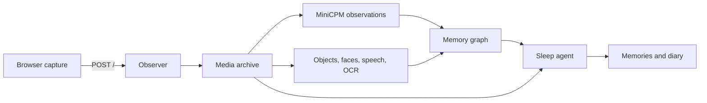

# Eleagent

**An elephant's memory. An agent's mind.**

A self-hosted personal memory system. Capture audio and video in a browser, retain the original evidence, organize observations into a graph, and consolidate the day into memories and a diary during a scheduled sleep cycle.

Eleagent is an experimental reference implementation. Its initial hardware profile uses two NVIDIA DGX Spark systems: daytime perception shares the GPUs with a larger model at night.

## Capture

The web application and upload endpoint share an origin:

- `GET /` serves the capture interface.
- `POST /` accepts a multipart `meta` JSON field and a `video` file, authenticated with a bearer token.
- Successful responses acknowledge durable archival. Repeating the same capture ID, sequence and content is idempotent.

The browser records separate short clips and uploads them in order. Keep the page in the foreground. Screen Wake Lock requests an awake display; it cannot prevent a deliberate lock or guarantee background recording. Interrupted capture is shown explicitly. Use HTTPS on phones. iOS 18.4 or later is recommended for home-screen use.

To deploy, follow the [agent deployment runbook](docs/agent-runbook.md).

## Repository

| Path | Responsibility |
| --- | --- |
| `apps/web` | Browser capture and bounded local upload queue |
| `services/observer` | Upload ingress and MiniCPM observation scheduling |
| `services/archive` | Original media and timestamped evidence |
| `services/recognition` | Face, object, speech and OCR workers |
| `services/graph-api` | Read API for the memory graph |
| `services/graph-sync` | Incremental graph synchronization |
| `services/sleep` | Pi memory tools, prompts and nightly consolidation |
| `runtime/gpu-manager` | Host GPU leases, draining and recovery |
| `deploy` | Versioned model and hardware recipes |

The local model route has a configured 524,288-token context window.

## Licensing

Original project code is AGPL-3.0-only unless a file states otherwise. Dependencies retain their own licenses. Model weights are obtained separately and are not covered by this repository's license.

**The DFlash2 draft weights in the experimental accelerated recipe use CC BY-NC-ND 4.0.** This recipe is not an unrestricted commercial model stack. Downloading weights yourself does not remove their license conditions. The pinned MiniCPM demo application also lacks an explicit source license; resolve its redistribution terms separately. See [third-party notices](THIRD_PARTY_NOTICES.md) and the model manifest before choosing a deployment.
