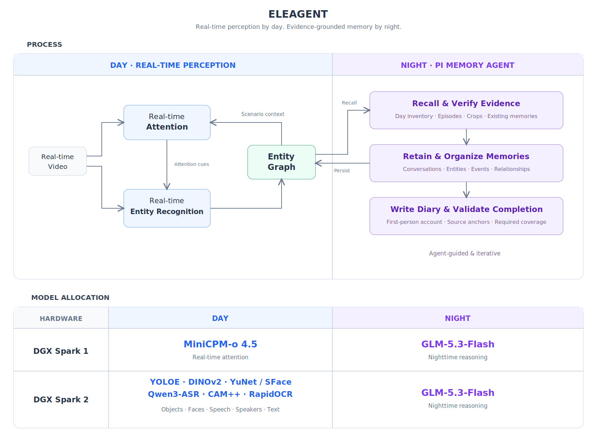

# Eleagent

**An elephant's memory. An agent's mind.**

A self-hosted personal memory system. Built with privacy as its starting point, Eleagent keeps all storage and model inference on your own hardware—no external LLM API calls.

Capture audio and video in a browser, retain the original evidence, organize observations into a graph, and consolidate the day into memories and a diary during a scheduled sleep cycle.

Eleagent is an experimental reference implementation. Its initial hardware profile uses two NVIDIA DGX Spark systems: daytime perception shares the GPUs with a larger model at night.

> [!WARNING]
> Eleagent is experimental and has no authentication. Anyone who can reach its services can upload recordings, read your memories and control the GPU handoff. Run it only on a trusted private network, and never expose it to the public internet.



## How to start

1. Get **two NVIDIA DGX Spark systems, each with 128 GB of unified memory**.
2. Verify that you can connect to both machines over SSH. On a computer with SSH access to both, open **Claude Code or Codex** and paste the prompt below:

```markdown
Help me deploy Eleagent (https://github.com/okou-ai/eleagent) to my DGX Spark cluster.

First, ask me to confirm the SSH targets for both machines. Do not begin deployment until I confirm them.

After I confirm the targets, follow the agent deployment runbook:
https://github.com/okou-ai/eleagent/blob/main/docs/agent-runbook.md
```

See the [agent deployment runbook](docs/agent-runbook.md) for the full deployment procedure.

## Licensing

Original project code is AGPL-3.0-only unless a file states otherwise. Dependencies retain their own licenses. Model weights are obtained separately and are not covered by this repository's license.

**The DFlash2 draft weights in the experimental accelerated recipe use CC BY-NC-ND 4.0.** This recipe is not an unrestricted commercial model stack. Downloading weights yourself does not remove their license conditions. The pinned MiniCPM demo application also lacks an explicit source license; resolve its redistribution terms separately. See [third-party notices](THIRD_PARTY_NOTICES.md) and the model manifest before choosing a deployment.

## References

Core research behind Eleagent's design.

1. T. J. Teyler and P. DiScenna, “[The hippocampal memory indexing theory](https://doi.org/10.1037/0735-7044.100.2.147),” *Behavioral Neuroscience*, vol. 100, no. 2, pp. 147–154, 1986.

2. J. L. McClelland, B. L. McNaughton, and R. C. O'Reilly, “[Why there are complementary learning systems in the hippocampus and neocortex: Insights from the successes and failures of connectionist models of learning and memory](https://doi.org/10.1037/0033-295X.102.3.419),” *Psychological Review*, vol. 102, no. 3, pp. 419–457, 1995.

3. P. A. Lewis and S. J. Durrant, “[Overlapping memory replay during sleep builds cognitive schemata](https://doi.org/10.1016/j.tics.2011.06.004),” *Trends in Cognitive Sciences*, vol. 15, no. 8, pp. 343–351, 2011.

4. B. A. Richards and P. W. Frankland, “[The persistence and transience of memory](https://doi.org/10.1016/j.neuron.2017.04.037),” *Neuron*, vol. 94, no. 6, pp. 1071–1084, 2017.

5. J. M. Zacks, N. K. Speer, K. M. Swallow, T. S. Braver, and J. R. Reynolds, “[Event perception: A mind-brain perspective](https://doi.org/10.1037/0033-2909.133.2.273),” *Psychological Bulletin*, vol. 133, no. 2, pp. 273–293, 2007.

6. E. K. Miller and J. D. Cohen, “[An integrative theory of prefrontal cortex function](https://doi.org/10.1146/annurev.neuro.24.1.167),” *Annual Review of Neuroscience*, vol. 24, pp. 167–202, 2001.

7. M. F. Land and M. Hayhoe, “[In what ways do eye movements contribute to everyday activities?](https://doi.org/10.1016/S0042-6989(01)00102-X),” *Vision Research*, vol. 41, nos. 25–26, pp. 3559–3565, 2001.

8. M. K. Johnson, S. Hashtroudi, and D. S. Lindsay, “[Source monitoring](https://doi.org/10.1037/0033-2909.114.1.3),” *Psychological Bulletin*, vol. 114, no. 1, pp. 3–28, 1993.

<details>
<summary>Design notes and implementation links</summary>

These are functional design influences—not claims of algorithm reproduction, biological equivalence, or validation of Eleagent.

- **Source-linked memory [1].** The graph retains selected memories and links; original media stays in the [archive](services/archive), accessible through [Sleep tools](services/sleep/extensions/memory.ts).
- **Day / night integration [2].** Fast [online perception](services/observer) feeds slower [nightly consolidation](services/sleep).
- **Abstraction and forgetting [3, 4].** [Sleep](services/sleep/prompts/sleep.md) consolidates fragments into reusable memories and lets low-value fragments fade, without deleting recordings.
- **Semantic events [5].** [Sleep](services/sleep/prompts/sleep.md) groups meaningful occurrences beyond fixed-duration capture buckets.
- **Context-guided attention [6, 7].** [Online situation context](services/observer/app/situation.py) feeds recent observations and recalled memories back into activity-oriented perception.
- **Source monitoring [8].** The [perception prompt](services/observer/app/situation.py) and [Sleep evidence rules](services/sleep/prompts/sleep.md) distinguish observations, reported speech, and interpretation—including device audio versus in-person speech.

</details>
