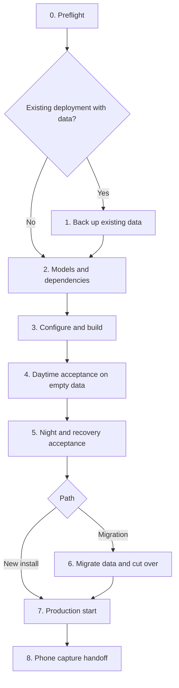

# Agent deployment runbook

This runbook is the entry point for an agent that installs Eleagent on two DGX Spark hosts, or moves an existing deployment's data onto Eleagent and makes it the production stack. It puts the existing guides in execution order and adds the acceptance and cutover procedures that the component guides do not cover.

Component guides stay authoritative for their details:

- [Dual-Spark deployment](../deploy/dual-spark/README.md): storage, credentials, Compose and GPU managers
- [Model preparation](../deploy/models.md), [Atlas](../deploy/atlas/README.md), [MiniCPM](../deploy/minicpm/README.md) and [recognition](../services/recognition/README.md)
- [Backup and restore](backup-and-restore.md) and the [capture protocol](capture.md)
- The dated [deployment validation record](deployment-validation.md), which records what this procedure was proven against

## How to use this runbook

Every phase states where it runs, its inputs, its success evidence, what to do on failure, and whether it is safe to repeat. Finish a phase and record its evidence before starting the next one. If an expected result does not appear, stop at that phase. Do not skip ahead.

Keep a private deployment record outside the repository, for example `<root>/private/` with mode `0700`. Write a small JSON receipt for each phase: time, repository revision, image IDs, counts, checksums and check results. These receipts let a later agent resume from the right phase. They may include host addresses and paths, but never put token values in them.

### Rules that apply to every phase

- **Data is irreplaceable; models and images are not.** Never delete, recreate, `chown -R` blindly or rewrite `DATA_ROOT`, a backup or an old deployment's data directory to make a step pass.
- **Never reset worker state to fix a stuck queue.** Observer, recognition, speech and OCR keep cursors and pending queues in their state directories. A worker with no state reads the whole archive from the beginning, so deleting state reprocesses all history.
- **Never weaken a check.** Do not edit `models.lock.json`, skip hash verification, or patch a model checkpoint in place. Local runtime changes belong in the converted overlay.
- **Never open a database with an older engine than the one that last wrote it,** and never run two database processes against one directory.
- **Credentials stay private.** Never commit `.env`, a rendered `docker compose config`, `docker inspect` output, a control token or TLS keys. Do not print token values to logs or chat.
- **Ask before downloading large artifacts.** Prefer verified local copies. Get the owner's approval before downloading multi-gigabyte weights, wheels or base images, and record which download steps were replaced by local copies.
- **Ask before irreversible or production-facing steps:** stopping a production deployment, retiring old services, or deleting anything.
- **Keep tracked files unchanged on hosts.** Put deployment-specific settings in private Compose override files and the private `.env`, not in tracked Compose files.

### Choose a path



- **New install:** no recordings exist yet. Phases 4 and 5 run on the same empty data directories that become production; reset them only with the owner's approval before Phase 7, because acceptance writes synthetic memories.
- **Migration:** an older deployment holds personal data. Phases 4 and 5 run in a separate validation root with empty data. Phase 6 then copies the old data into a new production root.

## Phase 0: Preflight

**Where:** both hosts. **Repeatable:** yes; read-only.

Collect the following and record them:

| Check | Command or source | Required result |
| --- | --- | --- |
| Architecture and OS | `uname -m`, `/etc/os-release` | `aarch64`, Linux |
| Docker and Compose | `docker version`, `docker compose version` | Compose 2.30 or newer |
| GPU containers | `docker info` runtimes; a short `nvidia-smi` container | NVIDIA runtime works |
| Service account | `id 1000` | Exists, has Docker access, owns the deployment root |
| Free space | `df -h` on the data, model and backup volumes | Archive reserve (100 GiB default) plus backup size plus models |
| Private network | Each host's private IPv4 address; ping between hosts | Both addresses reachable from each other |
| Atlas fabric | `ip -br link`, `ibv_devices` or equivalent | Interface and HCA names for the direct link, and rank 0's fabric address |
| Timezone | Owner's IANA timezone | One value used everywhere |
| Revision | `git rev-parse HEAD` on both hosts | Identical commit |
| Existing services | `docker ps -a`, `systemctl list-units --all` | Inventory of anything already using ports or GPUs |

Values that the agent must obtain rather than guess: the private addresses, fabric interface, HCA, rank-0 fabric address, timezone, owner display name and public capture hostname. Ask the owner when they cannot be read from the hosts.

**Stop if** the revisions differ, the service account is not UID 1000, or another process holds a listed port or GPU and the owner has not approved stopping it.

## Phase 1: Back up existing data

**Where:** both hosts, Migration path only. **Repeatable:** a new backup goes into a new directory; never overwrite an earlier one.

Follow [Back up a deployment](backup-and-restore.md) exactly. The essentials:

1. Record a private inventory of the old deployment: container names, image IDs, mounts, restart policies, environment and GPU manager units. Later phases need it for the cutover and for preserving credentials.
2. Wait until any night run has finished and both GPU managers are idle. Then stop the managers and every writer. Stop the graph database last.
3. Copy each host's complete data directories with ownership, permissions and SQLite `-wal`/`-shm` files. Resolve symlinks that point outside the copied roots.
4. Compare SHA-256 for every file. Run `PRAGMA integrity_check` on every SQLite copy. Run `neo4j-admin database check` against a disposable copy using **the same Neo4j image as the old deployment**.
5. Write the backup receipt.

**Success:** both hosts have a receipt with matching hashes, `ok` integrity results and a passing Neo4j check.
**On failure:** keep the old services stopped until you know why, or restart them from the inventory if the owner wants capture back. Do not proceed to Phase 6 without a verified backup.

Phases 4 and 5 reuse GPUs and ports. Leave the old deployment stopped while they run, or restart it between phases only with its recorded configuration.

## Phase 2: Models and dependencies

**Where:** each host prepares its own models. **Repeatable:** yes; verification never modifies model directories.

Create the storage layout from the [dual-Spark guide](../deploy/dual-spark/README.md#storage-and-permissions) first. The model directory must be writable by UID 1000; a root-owned model root makes later downloads fail.

Prepare in this order. Speech must be built before Silero can be extracted from it.

| Order | Host | Step | Guide |
| --- | --- | --- | --- |
| 1 | Spark 1 | Link or download `MiniCPM-o-4_5`; run `verify-model.py` and keep its metadata | [models](../deploy/models.md#reuse-local-files) |
| 2 | Spark 2 | Link or download `qwen3-asr-1.7b` and `campplus`; verify | [models](../deploy/models.md) |
| 3 | Spark 2 | Prepare face, object and OCR weights with the recognition scripts; they reuse files whose hashes match | [recognition](../services/recognition/README.md#model-preparation) |
| 4 | Spark 2 | Build the `speech` image (Phase 3), then extract `voice_silero.jit` from it with `--skip-ecapa` | [recognition](../services/recognition/README.md#model-preparation) |
| 5 | Both | Link or download the GLM and DFlash2 source checkpoints; verify both | [models](../deploy/models.md#optional-restricted-atlas-profile) |
| 6 | Both | Build Atlas (Phase 3), then run `convert-model.sh` in a maintenance window with free GPUs | [Atlas](../deploy/atlas/README.md#provisioning) |

Before downloading DFlash2, confirm that the owner accepts its CC BY-NC-ND 4.0 terms.

Atlas conversion reads the source checkpoints read-only and writes a separate `atlas-overlay`. Keep `conversion.complete.json`, `sparkglm-verified.json` and `eleagent-overlay.json`. The overlay links to the source checkpoint by absolute path, so do not move the source afterward.

**Success:** every `verify-model.py` run exits 0; the recognition scripts report matching hashes; both hosts have a complete Atlas overlay with its three receipt files.
**On failure:** a hash mismatch means the files differ from the pinned revision. Obtain correct bytes. Do not edit the lock or the files. A failed conversion leaves the source untouched; remove only the incomplete overlay and rerun.

## Phase 3: Configure and build

**Where:** both hosts. **Repeatable:** builds yes; credential and manager configuration generation refuse to overwrite.

1. **Private `.env`.** New install: generate it as in the [dual-Spark guide](../deploy/dual-spark/README.md#private-configuration), then copy the identical file to the other host. Migration: see [preserving credentials](#preserving-credentials) before creating it; the validation root still uses newly generated values.
2. **Images.** Build the CPU services, then `recognition` and `speech` on Spark 2, MiniCPM on Spark 1, and Atlas on both hosts. Use the documented cache options when large dependencies already exist locally:
   - MiniCPM: `MINICPM_WHEELHOUSE`, `MINICPM_SOURCE_DIR` or `MINICPM_CACHED_BASE_IMAGE` ([MiniCPM](../deploy/minicpm/README.md))
   - Recognition: `RECOGNITION_BASE_IMAGE` with `REUSE_INSTALLED_TORCH=1` ([recognition](../services/recognition/README.md#reusing-a-local-dependency-image))
   - Atlas: `ATLAS_NATIVE_ARTIFACTS_DIR`, `ATLAS_SOURCE_CACHE`, `ATLAS_CUDA_*_IMAGE` ([Atlas](../deploy/atlas/README.md#reusing-local-build-assets))

   Record every image ID and every cache override. A cached build validates the application source, not a fresh download of the default base.
3. **GPU managers.** Generate one control token, copy it to the other host, generate each host's configuration with `generate-config.py`, install the unit with the UID-1000 account, and enable it ([dual-Spark guide](../deploy/dual-spark/README.md#host-gpu-managers)). The manager timezone must equal `ELEAGENT_TIMEZONE`.
4. **Compose configuration.** Run `docker compose ... config --quiet` for each host file, including any private override file. Do not save its output.

**Success:** all images exist with recorded IDs; `config --quiet` passes on both hosts; `systemctl is-active eleagent-gpu-manager` is `active` and `GET /status` on each manager reports `idle` with no lease.
**On failure:** registry or network errors during builds are not reasons to edit Dockerfiles. Use a documented cache option, or report the missing dependency and ask whether a download is approved.

## Phase 4: Daytime acceptance on empty data

**Where:** a deployment whose data directories are empty. **Repeatable:** yes, but every run adds synthetic records to that deployment.

Start Spark 2's services, then Spark 1's daytime services. Do not start `sleep` yet:

```sh
# Spark 2
docker compose --env-file .env -f compose.spark2.yaml up -d --no-build
# Spark 1
docker compose --env-file .env -f compose.spark1.yaml up -d --no-build graph minicpm observer graph-api
```

Wait for readiness: Neo4j healthy, MiniCPM `/health` reporting `model_loaded: true`, recognition and speech readiness markers written, and `ready.py --config /etc/eleagent/gpu-manager.json` exiting 0 on both hosts as UID 1000. Model loading can take several minutes.

Create synthetic clips. Never use personal recordings for acceptance. This needs FFmpeg built with `flite` and `drawtext`:

```sh
# A test card with a synthetic voice, so speech and OCR both have input.
FONT=/usr/share/fonts/truetype/dejavu/DejaVuSans.ttf
ffmpeg -nostdin -v error -n \
  -f lavfi -i 'color=c=white:s=1280x720:r=15' \
  -f lavfi -i 'flite=text=We will review two designs tomorrow at ten in the morning.:voice=slt' \
  -vf "drawtext=fontfile=$FONT:text='DESIGN REVIEW':fontcolor=black:fontsize=58:x=(w-text_w)/2:y=220,drawtext=fontfile=$FONT:text='Tomorrow at 10 AM':fontcolor=black:fontsize=48:x=(w-text_w)/2:y=330" \
  -af apad -t 5 -c:v libx264 -pix_fmt yuv420p -c:a aac -ar 16000 -movflags +faststart clip.mp4
```

Upload each clip twice with identical metadata. The first response must be `"archived": true, "duplicate": false`; the second must have the same `media_id` and `sha256`, with `"duplicate": true`. `SCENE_API_TOKEN` must be loaded from the private `.env` in the current shell:

```sh
cat > meta.json <<'JSON'
{"capture_id": "acceptance-0001", "clip_seq": 0,
 "captured_at": "2026-04-14T09:00:00-07:00", "captured_end_at": "2026-04-14T09:00:05-07:00",
 "camera": "back", "source": "browser_media_recorder", "capture_gaps": [], "locations": []}
JSON
for attempt in 1 2; do
  curl -sS -H "Authorization: Bearer $SCENE_API_TOKEN" \
    -F 'meta=<meta.json' -F 'video=@clip.mp4;type=video/mp4' http://127.0.0.1:8080/
  echo
done
```

Increment `clip_seq` and the timestamps for further clips in the same capture. For Phase 5, set `captured_at` to the previous local day in the deployment's timezone.

Upload at least four consecutive clips and check each stage:

| Stage | Evidence |
| --- | --- |
| Ingress | Unauthenticated `POST /` returns `401`; `GET /` returns the page |
| Archive | `GET /v1/archive/feed?after=0` on Spark 2's archive with `SCENE_ARCHIVE_TOKEN` lists every clip with the right content type |
| MiniCPM | Observer logs or archive events show an observation per clip |
| Objects and faces | Recognition events for each clip |
| OCR | Baseline and focus OCR events for each clip, with no FFmpeg errors at clip boundaries |
| Speech | A transcript event close to the spoken sentence |
| Graph | `GET /v1/graph/entities?limit=200` on Spark 1's Graph API with `GRAPH_API_TOKEN` returns new entities |
| Backlog | Every worker's cursor equals the archive head and its pending queue is empty |

Also check the first-start backlog: stop one worker, upload a clip, start the worker, and confirm it processes the clip. A new worker started after clips were uploaded must process them from cursor zero.

**Success:** every row above has evidence, and the backlog is empty.
**On failure:** read the failing service's logs and its state. Fix code through a reviewed change, rebuild that one image, and restart that one service. Do not delete its state to clear an error.

## Phase 5: Night and recovery acceptance

**Where:** the same empty-data deployment. **Repeatable:** once per local night in that deployment's timezone; the scheduler records each completed night.

The scheduler acquires GPUs only between 00:30 and 05:00 local time in `ELEAGENT_TIMEZONE`, and only for days it has not slept yet. Either run this phase during that window, or, **for an isolated validation deployment only**, choose an IANA timezone whose current local time is inside the window. In that case, set the same value in that deployment's `.env` and both managers' `--timezone`. Never change a production timezone for testing: it moves day boundaries and the night window.

1. Confirm both managers are `idle` with no lease, and that the previous day in the deployment's timezone has synthetic clips (Phase 4).
2. Start the scheduler on Spark 1: `docker compose --env-file .env -f compose.spark1.yaml up -d --no-build sleep`.
3. Watch, without intervening:
   - Both managers move through `prepared` to running a rank; daytime GPU workers on both hosts drain and stop. Observer and CPU services keep running.
   - Both Atlas ranks become ready, rank 1 before rank 0.
   - The Pi run completes. Its tool calls include candidate image views, and it saves at least one conversation or event and a diary.
   - Scheduler state records the day as slept with no last error.
4. Confirm recovery: both managers return to `idle` with no lease and no rank container; MiniCPM, recognition and speech are running with fresh readiness markers; pause markers are gone; `ready.py` exits 0 on both hosts.
5. Upload one more clip and confirm every daytime stage processes it.
6. Read the saved memories through the Graph API and confirm they exist independently of scheduler logs.

**Success:** all six steps have evidence. Record lease timings, tool-call count and errors, memory counts and recovery state.
**On failure:** if a run fails, the managers restore daytime services at the hard deadline, when a lease expires, or after a manager restart. Wait for that, and confirm recovery before investigating. Do not start or remove Atlas rank containers by hand while a manager owns them. Keep the scheduler's run files: they are the evidence.

When this phase passes on the Migration path, stop the validation scheduler, wait for both managers to report `idle`, then stop the validation managers and containers. Keep the validation data as evidence; it is not migrated.

## Phase 6: Migrate data and cut over

**Where:** both hosts, Migration path only. **Repeatable:** copying into a non-empty destination is refused; to redo it, move the incomplete destination aside with the owner's approval and start again.

Phase 6 moves the old deployment's latest data into a new production root and makes Eleagent the deployment that runs from now on. Unlike the restore rehearsal in the backup guide, the old core services are not started again afterward.

### Preserving credentials

The new production `.env` must reuse the old deployment's values. Do not generate new ones:

| Variable | Why it must be preserved |
| --- | --- |
| `SCENE_API_TOKEN` | Phones, bookmarks and QR codes already carry it |
| `SCENE_ARCHIVE_TOKEN`, `GRAPH_API_TOKEN` | Existing internal clients and graph readers use them |
| `NEO4J_PASSWORD` | An existing database keeps its stored password; the container variable only sets the password of a new database |
| `ELEAGENT_TIMEZONE` | Diary days, sleep dates and the night window are computed in it |
| `ELEAGENT_OWNER_NAME` | Keeps the sleep agent's owner identity unchanged |

Read these values from the old deployment's private configuration or from the Phase 1 inventory. Write them straight into a mode-0600 `.env` without printing them. Assert that the same credential agrees across every old service that uses it. Use the same file on both hosts.

### Keep the graph engine version

The tracked Compose file pins a default Neo4j image. Before starting the migrated database, read the engine version the old deployment ran, for example from its image or `neo4j --version` inside that image. If it differs from the tracked default, keep the old engine:

1. Tag the old image ID under a local name, for example `local/eleagent-neo4j:<version>-migrated`.
2. Add a private Compose override, outside the repository, that sets `graph.image` to that tag. Set `graph.user` to the UID:GID that owns the copied store if it differs from the default `7474`. Also carry over any non-default database settings from the old container.
3. Start Spark 1 through a small private launcher that always passes the override after the tracked Compose file, so later restarts cannot fall back to the default image.

An older engine must never open a store written by a newer one. Upgrading the engine is a separate, explicitly approved operation with its own backup.

The same private override is the place for other deployment-specific settings carried from the old stack. For example, if the existing HTTPS ingress forwards to a different observer listener or uses TLS to the observer, configure that in the override rather than in tracked files.

### Copy

1. **Quiesce.** Confirm that every old writer and the old GPU managers are still stopped, and that no night run is in progress. If the old stack was restarted after Phase 1, stop it again in the same order and take this copy from that newer state. Phase 1's backup remains the rollback point.
2. **Map directories.** Map each old data directory to its new role and record the map:

   | Host | New directory under `DATA_ROOT` | Contents |
   | --- | --- | --- |
   | Spark 1 | `observer` | Ingress state, MiniCPM cursor and queue |
   | Spark 1 | `sleep` | Scheduler state (`scheduler.json`), run history |
   | Spark 1 | `neo4j` | Graph store `data` (and `logs`) |
   | Spark 2 | `archive` | Original media and archive databases |
   | Spark 2 | `recognition` | Entities, voice identities, speech and OCR state, cursors |

   **Copy worker state together with the archive.** If the archive is copied without the observer and recognition state, every worker starts from cursor zero and reprocesses all history.
3. **Copy.** Copy each source into a destination that does not exist yet, preserving attributes (`cp -a --reflink=auto SRC DST`). Refuse symlinks inside data directories unless their targets are copied too.
4. **Verify.** Compare SHA-256 for every file between source and destination before changing anything. Then, with no process holding the databases, remove copied SQLite `-shm` files, run `PRAGMA integrity_check` on every SQLite database (which replays its WAL), and run `neo4j-admin database check` with the retained engine.
5. **Ownership.** Apply the ownership from the [storage table](../deploy/dual-spark/README.md#storage-and-permissions): archive UID 10001 with group-readable databases, Neo4j as chosen above, everything else UID 1000.
6. **Receipt.** Record file counts, bytes, checksum results, database checks and the directory map.

### Start and verify

Start Spark 2, then Spark 1's daytime services, as in Phase 4, using the production `.env` and the private override. Before starting `sleep`, verify:

| Check | Required result |
| --- | --- |
| Archive | Media count, event count and ingest head equal the old deployment's |
| Worker progress | Every observer, recognition, speech and OCR cursor equals the archive head; pending queues are empty or match the old values |
| No reprocessing | Worker event counts do not jump after startup |
| Identity data | Entity, sample and voice-identity counts equal the old deployment's |
| Graph | Graph API returns the old entity and link counts using the preserved `GRAPH_API_TOKEN` |
| Sleep state | `scheduler.json` shows the last day the old deployment slept |
| Ingress | `GET /` 200 and unauthenticated `POST /` 401 through the public origin |
| GPUs | Both managers `idle`, `ready.py` exits 0 on both hosts |

Then start `sleep`. Its next run is the next scheduled local night; do not trigger a manual night run against production data.

### Retire the old stack

Ask the owner before this step. Then:

1. Stop the old core containers and set their restart policy to `no` (`docker update --restart=no`). Do not remove them.
2. Stop and disable the old GPU manager units and any validation manager units. Only the new `eleagent-gpu-manager` stays enabled.
3. Point surrounding services, such as the HTTPS ingress, tunnels and monitoring, at the new containers. Keep the public origin unchanged.
4. Keep the old data directories, the old containers and the Phase 1 backup. Removing them needs a separate retention decision from the owner.
5. Write the cutover receipt: preserved counts, image IDs, private override path, retired services and backup location.

**On failure before retirement:** stop the new stack and restart the old one from its inventory; its data was only read. **On failure after retirement:** stop the new stack, verify Phase 1's backup, and ask the owner before restoring, because new recordings may exist only in the new root.

## Phase 7: Production start

**Where:** both hosts. **Repeatable:** yes.

- **New install:** with the owner's approval, stop the stack, replace the acceptance data directories with empty ones (Phase 3 storage commands), and start again as in Phase 4. Start `sleep` only after both managers are ready.
- **Both paths:** confirm restart policies are `unless-stopped`, the managers are enabled, only the HTTPS origin is reachable from outside, and the private ports are bound as listed in the [listener table](../deploy/dual-spark/README.md#build-and-start).

The next morning, check that the scheduler recorded the night with no error, both managers are `idle`, daytime services recovered, and the diary exists in the graph.

## Phase 8: Phone capture handoff

**Where:** Spark 1 and the owner's phone. **Repeatable:** yes.

1. Put HTTPS in front of the observer ([installation](install.md#https-for-the-browser)). Confirm `GET /` over HTTPS from outside the private network.
2. Give the owner a private link `https://<capture-host>/#token=<URL-encoded SCENE_API_TOKEN>` or a QR code of it ([capture protocol](capture.md)). Share it only through a private channel and store the image with restricted visibility.
3. The owner taps **Start recording** and allows the camera and microphone. They should keep the page in the foreground and speak normally for 10–15 seconds.
4. Confirm on the servers: new clips archived, MiniCPM, recognition, OCR and speech events for them, a non-empty transcript, and queues draining. Short queues after a burst of buffered uploads are normal; a growing backlog is not.

**Success:** the owner's own clips reach every stage, and speech produces text.
**On failure:** check upload responses first (401 means a wrong token; a conflict means a reused identity), then the per-stage table in Phase 4.

## What this runbook has and has not been proven against

The full sequence ran on 2026-10-16, with local copies of weights and large dependencies. See the [validation record](deployment-validation.md). That run included the Migration path for 8,669 historical clips with no reprocessing. A build that downloads every default base dependency from public sources has not been run. MiniCPM's default public base in particular remains unverified. Phone behavior over long sessions is outside this runbook; see [limitations](limitations.md).
